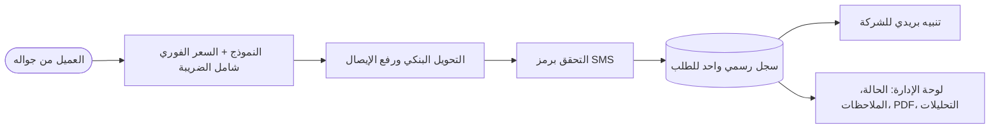
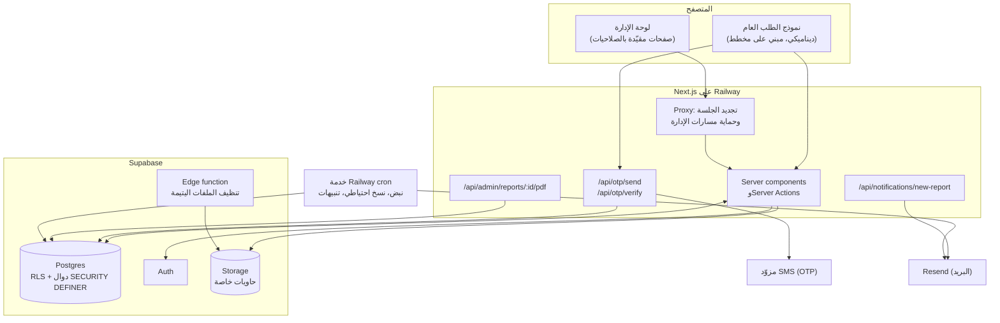
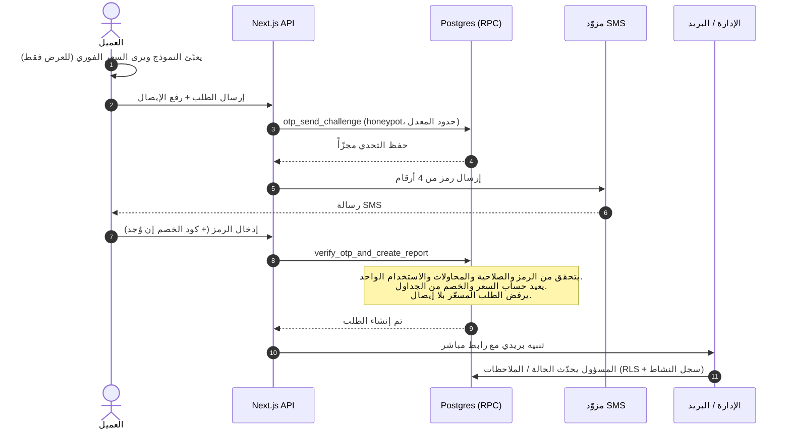

🇬🇧 [English](README.md) | 🇸🇦 العربية

# منصة طلبات صيانة المكيفات

**نظام طلبات يعمل من الجوال أولاً، يربط الطلب بالدفع المسبق، ومعه لوحة تحكم إدارية كاملة، نقل شركة تكييف من الرسائل والمكالمات المتفرقة إلى مسار واحد مُراقَب ومُسعَّر ومدفوع.**

---

## المحتويات

[المشكلة](#المشكلة) · [الحل](#الحل) · [الأثر التجاري: قبل وبعد](#الأثر-التجاري-قبل-وبعد) · [المميزات الرئيسية](#المميزات-الرئيسية) · [التقنيات المستخدمة](#التقنيات-المستخدمة) · [بنية النظام](#بنية-النظام) · [لقطات الشاشة](#لقطات-الشاشة) · [دوري](#دوري-في-المشروع) · [ملاحظة حول الشيفرة](#ملاحظة-حول-الشيفرة-المصدرية)

---

## المشكلة

العميل شركة سعودية متخصصة في مقاولات التكييف، تبيع خدمات **تركيب** و**صيانة** المكيفات للمنازل والمواقع التجارية. كانت الطلبات تصل عبر المكالمات والرسائل، ويتعامل معها كل مهندس بطريقته الخاصة. نتج عن ذلك أربع مشاكل تشغيلية متراكمة:

| # | المشكلة | أثرها على الشركة |
|---|---------|------------------|
| 1 | **بطء التعامل مع الطلبات وغياب المراقبة** | لا توجد جهة واحدة تُظهر ما هي الطلبات الموجودة، ومن يتولاها، وكم مضى عليها. قد يبقى الطلب بلا حركة دون أن ينتبه أحد. |
| 2 | **تأخر بعض العملاء ومماطلتهم في الدفع** | كانت الأعمال تُجدول قبل تحصيل المبلغ. ومطاردة الدفعات بعد الزيارة عطّلت التدفق النقدي واستهلكت وقت الإدارة. |
| 3 | **تشتّت الطلبات بين المهندسين** | كل مهندس يحتفظ بقائمته. لا سجل رسمي للشركة، ولا صيغة موحدة لاستقبال الطلب، ولا إمكانية لإعادة التوزيع أو المراجعة. |
| 4 | **غموض التسعير** | كانت الأسعار تُعطى بحسب الموقف، فقد يُسعَّر العميلان بشكل مختلف لنفس العمل. والنتيجة: مساومة وعدم ثقة ونزاعات لاحقة. |

هذه ليست أربع مشاكل منفصلة، بل لها جذر واحد: **لم يكن لدى الشركة نظام مرجعي رسمي في اللحظة التي يقول فيها العميل «أحتاج الخدمة».**

## الحل

جعلت المنصة **الطلب نفسه هو السجل الرسمي**. كل شيء يبدأ من نموذج عام واحد مصمم للجوال، وكل ما بعده مبني على هذا السجل.

1. **بوابة استقبال رسمية واحدة.** يعبّئ العميل نموذجاً عربياً قصيراً من جواله. تصل كل الطلبات إلى قاعدة البيانات نفسها وبالهيكل نفسه، أياً كان من سينفذها.
2. **السعر يظهر قبل أن يلتزم العميل.** الأسعار شاملة الضريبة، وتُحسب لحظياً من جداول الشركة نفسها، ويظهر إجمالي متحرك. يرى العميل بالضبط ما سيدفعه ولماذا.
3. **الدفع جزء من الطلب.** في الطلبات المسعّرة يحوّل العميل المبلغ ويرفع **إيصال التحويل ضمن الإرسال نفسه**. يرفض الخادم أي طلب مسعّر بلا إيصال، فلا يدخل المسار طلب غير مدفوع.
4. **التحقق من الهوية برسالة نصية.** لا يُنشأ الطلب إلا بعد إدخال رمز يصل إلى جوال العميل، مما يصفّي الطلبات الوهمية وأخطاء الأرقام.
5. **لوحة مركزية للشركة.** يرى المسؤولون كل الطلبات في قائمة واحدة، وينقلونها عبر مسار حالات، ويضيفون ملاحظات داخلية، ويصدّرون PDF للفني، ويطالعون تحليلات الحجم والإيرادات وسلوك النموذج. الوصول بالصلاحيات، وكل إجراء حساس يُسجَّل في سجل نشاط.

## الأثر التجاري: قبل وبعد

| المجال | قبل المنصة | بعد المنصة |
|--------|-----------|-----------|
| **رؤية الطلبات** | موزعة بين المكالمات والرسائل والقوائم الشخصية، بلا نظرة شاملة | قائمة واحدة قابلة للبحث والتصفية بالحالة والمدينة والجوال ورقم الطلب، وتنبيه بريدي لكل طلب جديد |
| **المتابعة** | الحالة في ذاكرة شخص ما | مسار صريح: *جديد ← قيد المعالجة ← منجز / ملغي* مع ملاحظات داخلية لكل طلب |
| **الدفع** | يُحصَّل بعد العمل وغالباً متأخراً | يُحصَّل **عند الإرسال**؛ لا يُنشأ طلب مسعّر بدون إيصال تحويل |
| **التدفق النقدي** | يعتمد على حسن نية العميل | المبلغ يصل قبل جدولة الزيارة، والتنفيذ يبدأ بعد استلام الحوالة |
| **جدية العميل** | أي شخص يستطيع «الحجز» دون كلفة | الدفع والتحقق من الجوال يصفّيان الطلبات غير الجادة |
| **التسعير** | شفهي ويختلف من عميل لآخر | جداول أسعار معتمدة؛ نفس العمل بنفس السعر وظاهر مسبقاً؛ والخصومات تُدار بأكواد لا بالمساومة |
| **نزاعات الأسعار** | متكررة ولا يوجد سجل بما اتُّفق عليه | السعر الظاهر على الشاشة هو المحفوظ في الطلب، ويعيد الخادم حسابه |
| **عمل المهندسين** | كل مهندس بقناته الخاصة | منصة رسمية واحدة للشركة؛ ويستلم الفني ملف PDF **بلا أسعار** |
| **المساءلة** | لا شيء | صلاحيات تفصيلية للمسؤولين وسجل يوضح من غيّر ماذا ومتى |
| **القرارات** | بالحدس | تحليلات: الطلبات عبر الزمن، حسب المدينة والخدمة ونوع المكيف، الإيرادات حسب الخدمة، الطلبات التي تحتاج انتباهاً |

> **ملاحظة حول الأرقام.** يصف هذا المستند نموذج التشغيل الذي يفرضه النظام. ولا يدّعي عمداً نسب تحسّن مئوية، لأنها تعتمد على بيانات الشركة نفسها قبل التطبيق وبعده. وحدة التحليلات مبنية لتتمكن الشركة من قياسها منذ اليوم الأول.

## المميزات الرئيسية

### جهة العميل (الجوال أولاً، عربي RTL)

  

<table>
  <tr>
    <td align="center" width="25%"> <b>١ · التعريف</b> الاسم + جوال سعودي (+966)، مع توضيح رمز التحقق مسبقاً</td>
    <td align="center" width="25%"> <b>٢ · الإعداد والتسعير</b> نوع وقدرة وعدد كل مكيف، والسعر يتحدث لحظياً</td>
    <td align="center" width="25%"> <b>٣ · المراجعة</b> ملخص مفصّل وكود الخصم</td>
    <td align="center" width="25%"> <b>٤ · الدفع</b> بيانات التحويل مع أزرار نسخ ورفع الإيصال <i>(تم تمويه البيانات البنكية)</i></td>
  </tr>
</table>

- **محرك تسعير مبني على الخدمة.** يختار العميل الخدمة (تركيب، صيانة) ثم الفئة لكل مكيف (وقائية، كشفية، غسيل، تعبئة فريون). تأتي الأسعار من ثلاثة جداول شاملة الضريبة يعدّلها المسؤول (التركيب، الصيانة، الفريون حسب نوع الغاز).
- **طلبات متعددة المكيفات.** يتيح الحقل المتكرر وضع عدة مكيفات في طلب واحد، لكل منها نوعه وقدرته وكميته وفئته، فيُسعَّر الطلب المختلط بشكل صحيح دفعة واحدة.
- **السلطة النهائية للسعر في الخادم.** يحسب المتصفح السعر للعرض فقط. أما دالة قاعدة البيانات التي تنشئ الطلب فـ**تعيد حساب الإجمالي من جداول الأسعار وتتجاهل أي قيمة أرسلها العميل**.
- **كوبونات الخصم.** أكواد بمبلغ ثابت أو نسبة مع تاريخ انتهاء اختياري. يعيد الخادم التحقق من الكود عند الإرسال؛ والكود المنتهي أو المعطّل يرفض الإرسال بدل أن يُحاسَب العميل بالسعر الكامل بصمت.
- **مسار التسعير اليدوي.** الطلبات «الأخرى» التي ليس لها سعر ثابت تُعلَّم بـ«بحاجة لتسعير» وتتواصل الشركة مع العميل، دون فرض قسم التحويل البنكي.
- **إثبات الدفع.** بيانات التحويل مع أزرار نسخ سريعة، ورفع إيصال إلزامي (صورة أو PDF) للطلبات المسعّرة.
- **التحقق من الجوال (OTP).** لا يُنشأ الطلب إلا بعد رمز صحيح من ٤ أرقام عبر SMS (صلاحية ١٠ دقائق، محاولات محدودة، استخدام لمرة واحدة). تُخزَّن الرموز مجزّأة (hash) مع «بهار» (pepper) خاص بالخادم.
- **الحماية من إساءة الاستخدام.** حقل مصيدة مخفي (honeypot)، وحدود معدّل لكل جوال ولكل جلسة، وحارس يمنع الإرسال المتكرر السريع.
- **مدخلات ذكية.** توحيد أرقام الجوال السعودية بصيغة E.164، وقبول الأرقام العربية والإنجليزية، ورابط خرائط Google أو وصف نصي للموقع، وحقول شرطية تظهر فقط عند الحاجة.

### لوحة الإدارة

  

- **صندوق الطلبات.** بحث برقم الجوال أو رقم الطلب، وتصفية بالحالة والمدينة، وعرض السعر والتاريخ بنظرة واحدة، وإضافة طلب يدوياً (لطلبات الهاتف)، وحذف نهائي مع تحذير صريح.
- **تفاصيل الطلب.** كل الإجابات، والملفات المرفوعة (عبر روابط موقّعة قصيرة العمر)، وتفصيل السعر، والتحكم بالحالة، والملاحظات الداخلية.
- **تصدير PDF للفني.** ورقة نظيفة للطباعة تُنتج من عرض المتصفح الحقيقي (Puppeteer) فتظهر الحروف العربية سليمة. وهي **لا تعرض الأسعار** عن قصد، فيرى الفني ما عليه تنفيذه لا ما دُفع.
- **تنبيهات بريدية فورية.** كل طلب جديد، سواء من العميل أو أدخله مسؤول، يرسل بريداً بهوية الشركة مع رابط مباشر للطلب.
- **التحليلات.** بطاقات مؤشرات، والإيرادات حسب الخدمة، والطلبات عبر الزمن (٣٠ / ٩٠ يوماً)، وحسب الحالة والمدينة والخدمة ونوع المكيف، ولوحة «يحتاج انتباه»، إضافة إلى **رؤى تجربة النموذج**: نسبة الإكمال، ومتوسط زمن الإكمال، والحقل الذي يتوقف عنده المستخدمون. وتأتي من أحداث خفيفة غير شخصية.
- **محرر النموذج.** إضافة الأقسام والحقول وتعديلها وإعادة ترتيبها وإخفائها وحذفها، وإدارة خيارات القوائم داخل الحقل، وضبط الظهور الشرطي، ومعاينة النموذج الحي، كل ذلك دون نشر جديد. الحقول التي لها إجابات سابقة تُخفى ولا تُحذف حفظاً للبيانات التاريخية، وحقل الجوال محمي.
- **محررا الأسعار والكوبونات.** تعديل كل سعر وإدارة أكواد الخصم من الواجهة. تنعكس التغييرات فوراً على النموذج العام وعلى الحساب في الخادم.
- **المسؤولون والصلاحيات.** إنشاء مسؤولين ومنحهم صلاحيات لكل صفحة (الطلبات، محرر النموذج، الإعدادات، التحليلات). ويملك مسؤول رئيسي واحد صلاحيات كاملة دائماً.
- **سجل النشاط.** كل إجراء حساس (تغيير الحالة، الحذف، تغيير الصلاحيات، تعديل الحقول، الإعدادات) يُسجَّل باسم منفّذه، ويظهر للمسؤول الرئيسي فقط ويمكن تصفيته بالمسؤول أو نوع الإجراء.
- **إعدادات الهوية.** عنوان الموقع واسم الشركة والشعار وألوان العلامة قابلة للتعديل مع معاينة حية.

## التقنيات المستخدمة

| الطبقة | التقنية |
|--------|--------|
| **الإطار** | Next.js 16 (App Router، Server Actions، route handlers) |
| **الواجهة** | React 19، TypeScript 5، Tailwind CSS 4، خط تجوال، تخطيط RTL أولاً |
| **قاعدة البيانات** | Supabase Postgres مع Row-Level Security ودوال RPC من نوع `SECURITY DEFINER` |
| **المصادقة** | Supabase Auth (بريد + كلمة مرور) للوحة الإدارة |
| **تخزين الملفات** | Supabase Storage مع حاويات خاصة (إيصالات، صور، فيديو، فواتير) وحاوية عامة واحدة للهوية |
| **الرسائل / OTP** | مزوّد OurSMS خلف واجهة قابلة للاستبدال، مع وضع محاكاة للتطوير المحلي |
| **البريد** | Resend (تنبيهات الطلبات الجديدة وتنبيهات التشغيل) |
| **PDF** | Puppeteer (عرض عبر Chromium بلا واجهة) |
| **الاستضافة** | Railway: خدمة الويب وخدمة cron منفصلة |
| **المهام المجدولة** | Railway cron (نبض إبقاء، نسخ احتياطي، تنبيهات استهلاك، ملخص أسبوعي) و`pg_cron` مع edge function (تنظيف الملفات اليتيمة) |

## بنية النظام

### دورة حياة الطلب

هذا التسلسل هو لبّ التصميم: متصفح العميل لا يُوثق به أبداً في السعر أو الهوية أو صلاحية إنشاء الطلب.

### نموذج الأمان

- **لا كتابة مباشرة على جدول الطلبات.** ليس لدور `anon` ولا `authenticated` صلاحية `INSERT` على جدول الطلبات. الإنشاء ممكن فقط عبر دالة `SECURITY DEFINER` لا يُوصل إليها إلا من مسار التحقق في الخادم.
- **تفويض بطبقتين.** تُطبَّق صلاحيات المسؤولين في التطبيق (حراس الصفحات) وفي Postgres (RLS عبر دالة مساعدة للصلاحيات)، فإذا تجاوز أحدهم الواجهة اصطدم بجدار قاعدة البيانات.
- **الخصوصية افتراضياً.** الإيصالات والصور والفيديو في حاويات خاصة لا يقرأها إلا مسؤول يملك صلاحية الطلبات؛ وحاوية الهوية هي الوحيدة العامة.
- **التحليلات الحساسة مقيّدة.** تمر التحليلات عبر دوال RPC تفحص الصلاحيات بدل القراءة المباشرة من الجداول.
- **تحصين إضافي.** ترويسات أمان (HSTS، `X-Frame-Options: DENY`، `nosniff`، سياسة الـ referrer)، وتعطيل رمز اختبار OTP قسراً في أي بيئة إنتاج، وبقاء الأسرار في الخادم فقط.

## لقطات الشاشة

### العميل (الجوال)

  
  
  
  

### لوحة الإدارة

| | |
|---|---|
|  صندوق الطلبات مع البحث والتصفية |  تفاصيل الطلب وتصدير PDF |
|  مسار الحالات والملاحظات الداخلية |  محرر النموذج: الأقسام والحقول والشروط |
|  التحليلات: المؤشرات والإيرادات |  الطلبات عبر الزمن وحسب الحالة والمدينة |
|  رؤى تجربة النموذج ولوحة «يحتاج انتباه» |  الهوية والمعاينة الحية |
|  محرر جداول الأسعار (شاملة الضريبة) |  كوبونات الخصم |
|  المسؤولون والصلاحيات لكل صفحة |  سجل النشاط (للمسؤول الرئيسي فقط) |

> تم تمويه البيانات الشخصية في اللقطات (أسماء العملاء وأرقام جوالاتهم والبيانات البنكية وأسماء الموظفين).

<!-- ## تجربة مباشرة
أضف رابط النسخة المنشورة هنا إن رغبت. -->

## دوري في المشروع

حلّلت سير عمل الشركة وتولّيت المنتج من البداية إلى النهاية:

- **المنتج والتحليل:** حدّدت المشاكل التشغيلية الأربع أعلاه وحوّلتها إلى مسار الطلب والدفع والتسعير.
- **تجربة المستخدم:** صمّمت نموذج الطلب العربي (RTL) المخصص للجوال أولاً، ولوحة الإدارة.
- **هندسة متكاملة (Full-stack):** واجهة ومنطق خادم بـ Next.js وTypeScript، ومخطط Postgres وسياسات RLS ودوال RPC على Supabase.
- **الأمان:** سلطة السعر في الخادم، والتحقق عبر OTP، وحدود المعدل، والتخزين الخاص، ونموذج الصلاحيات، وسجل النشاط.
- **التسليم والتشغيل:** النشر على Railway، وربط الرسائل والبريد، والنسخ الاحتياطي المجدول، ومراقبة النبض والاستهلاك.

## ملاحظة حول الشيفرة المصدرية

هذا المستودع **عرض توضيحي** للمشروع: التحليل والبنية ولقطات الواجهات. الشيفرة المصدرية خاصة لأن النظام تجاري يعمل فعلياً لصالح عميل، وقد تم تمويه اللقطات لإخفاء البيانات الشخصية والبنكية.

## الرخصة

التوثيق والصور مشاركة لأغراض عرض الأعمال. جميع الحقوق محفوظة.

