🇬🇧 English | 🇸🇦 [العربية](README.ar.md)

# AC Maintenance Request Platform

**A mobile-first, pay-upfront request system with a full admin console — built to move an HVAC contractor from scattered chats and phone calls to one monitored, priced and paid pipeline.**

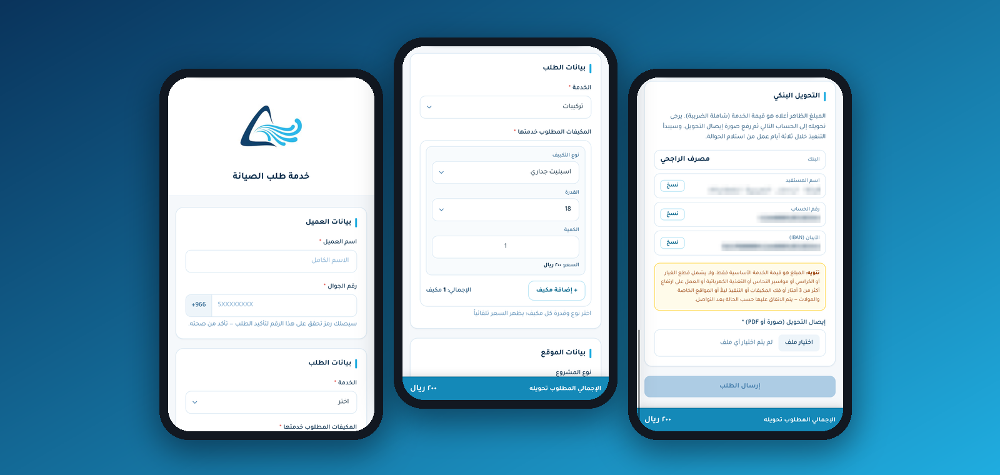

---

## Table of Contents

[The Problem](#the-problem) · [The Solution](#the-solution) · [Business Impact: Before vs After](#business-impact-before-vs-after) · [Key Features](#key-features) · [Tech Stack](#tech-stack) · [System Architecture](#system-architecture) · [Screenshots](#screenshots) · [My Role](#my-role) · [Source Code Notice](#source-code-notice)

---

## The Problem

The client is a Saudi HVAC contracting company that sells air-conditioner **installation** and **maintenance** to homes and commercial sites. Requests arrived through phone calls and chat messages and were handled informally by individual engineers. That created four compounding operational problems:

| # | Problem | Why it hurt the business |
|---|---------|--------------------------|
| 1 | **Slow, unmonitored request handling** | No single place showed which requests existed, who had them, or how old they were. Requests could sit untouched and nobody would know. |
| 2 | **Customers delaying or dodging payment** | Work was scheduled before money was collected. Chasing payments after the visit stalled cash flow and consumed management time. |
| 3 | **Requests scattered across engineers** | Each engineer kept their own list. There was no official company record, no common intake format, and no way to reassign or audit work. |
| 4 | **Opaque pricing** | Prices were quoted ad hoc, so two customers could be quoted differently for the same job. The result: haggling, mistrust and disputes after the fact. |

These are not four separate issues. They share a root cause: **the company had no system of record at the point where a customer says "I need service."**

## The Solution

The platform makes the request itself the system of record. Everything starts in one public, mobile-first form, and everything downstream hangs off that single record.

1. **One official intake.** Customers fill in a short Arabic (RTL) form on their phone. Every request lands in the same database with the same structure, whoever ends up serving it.
2. **Price is shown before the customer commits.** Prices are VAT-inclusive, calculated live from the company's own price tables, and shown as a running total. The customer sees exactly what they will pay and why.
3. **Payment is part of the request.** For priced requests the customer transfers the amount by bank transfer and **uploads the receipt as part of submitting**. The server rejects a priced submission with no receipt, so a request cannot enter the pipeline unpaid.
4. **Identity is verified by SMS.** The request is created only after the customer enters a one-time code sent to their phone, which filters out fake and mistyped submissions.
5. **A central console for the company.** Admins see every request in one list, move it through a status workflow, add internal notes, export a technician PDF, and read analytics on volume, revenue and form behaviour. Access is permission-based and every sensitive action is audit-logged.

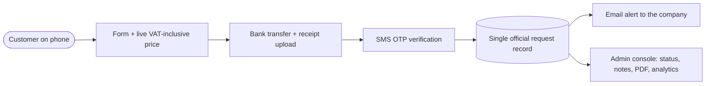

## Business Impact: Before vs After

| Area | Before the platform | After the platform |
|------|--------------------|--------------------|
| **Request visibility** | Spread across calls, chats and personal lists; no overview | One searchable list filtered by status, city, phone or request number; new requests trigger an email alert |
| **Tracking** | Status lived in someone's memory | Explicit workflow: *New → In progress → Completed / Cancelled*, with internal notes per request |
| **Payment** | Collected after the work, often late | Collected **at submission**; a priced request cannot be created without a transfer receipt |
| **Cash flow** | Dependent on customers' goodwill | Money is in before the visit is scheduled; execution is promised after the transfer is received |
| **Customer commitment** | Anyone could "book" with no cost | Paying and verifying a phone number filters out non-serious requests |
| **Pricing** | Quoted verbally, varied per customer | Published price tables; same job, same price, shown up front; discount codes handled by rules, not negotiation |
| **Pricing disputes** | Frequent, with no record of what was agreed | The price shown on screen is the price stored on the request, recomputed by the server |
| **Engineers' work** | Each engineer on their own channel | One official company platform; engineers receive a technician PDF with **no prices** on it |
| **Accountability** | None | Granular admin permissions plus an audit log of who changed what and when |
| **Decisions** | Gut feeling | Analytics: requests over time, by city / service / AC type, revenue by service, requests needing attention |

> **A note on numbers.** This document describes the operating model the system enforces. It deliberately makes no claim about percentage improvements, because those depend on the company's own before-and-after data. The analytics module is built so the company can measure them from day one.

## Key Features

### Customer side (mobile-first, Arabic / RTL)

  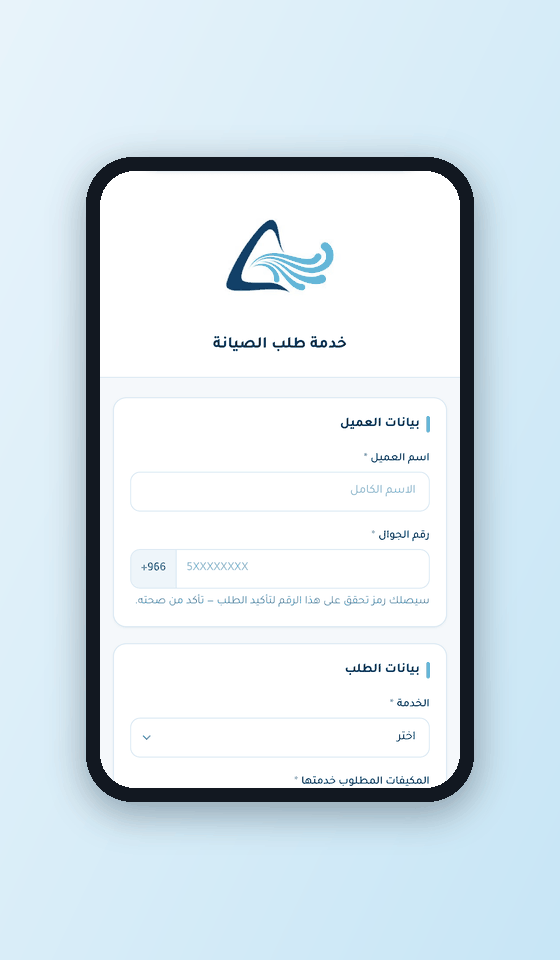

<table>
  <tr>
    <td align="center" width="25%">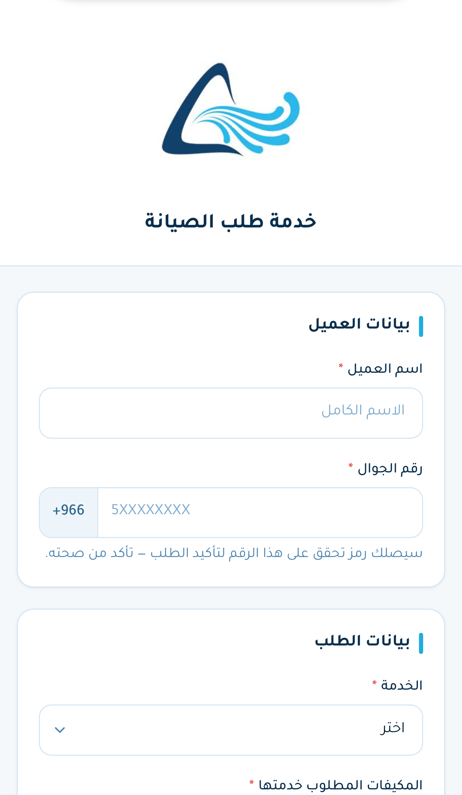 <b>1 · Identify</b> Name + Saudi mobile (+966), SMS code explained up front</td>
    <td align="center" width="25%">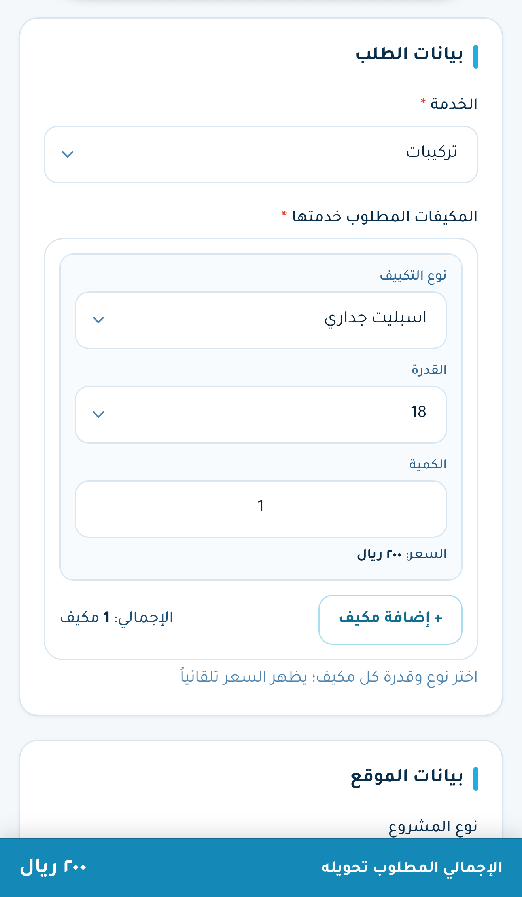 <b>2 · Configure &amp; price</b> Per-unit type, capacity, quantity; price updates live</td>
    <td align="center" width="25%"> <b>3 · Review</b> Itemised summary and discount code</td>
    <td align="center" width="25%">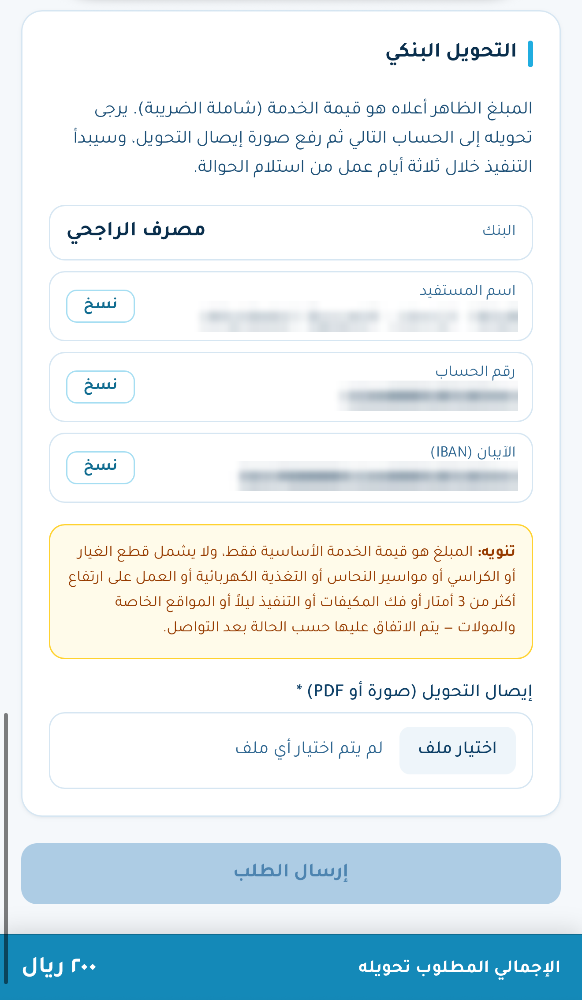 <b>4 · Pay</b> Transfer details (copy buttons) and receipt upload <i>(bank details blurred)</i></td>
  </tr>
</table>

- **Service-driven pricing engine.** The customer picks a service (installation, maintenance), then a category per AC unit (preventive, inspection, washing, freon refill). Prices come from three admin-editable, VAT-inclusive tables (installation, maintenance, freon by gas type).
- **Multi-unit requests.** A repeater lets one request contain several units, each with its own type, capacity and quantity, and its own category, so a mixed order is priced correctly in one go.
- **Server-side price authority.** The browser calculates the price for display only. The database function that creates the request **recomputes the total from the price tables and ignores whatever the client sent**.
- **Discount coupons.** Fixed-amount or percentage codes with optional expiry. The server revalidates the code at submission; an expired or disabled code rejects the submit instead of silently charging full price.
- **Manual-pricing path.** "Other" requests that have no fixed price are flagged *needs pricing* and the company contacts the customer; no bank section is forced on them.
- **Payment proof.** Bank-transfer details with one-tap copy buttons and a required receipt upload (image or PDF) for priced requests.
- **Phone verification (OTP).** The request is created only after a correct 4-digit SMS code (10-minute expiry, limited attempts, single use). Codes are stored hashed with a server-side pepper.
- **Abuse protection.** Hidden honeypot field, per-phone and per-session rate limits, and a short burst guard against repeat submissions.
- **Smart inputs.** Saudi phone normalisation to E.164, Arabic and English digits accepted, Google Maps link or free-text location, conditional fields that appear only when relevant.

### Admin console

  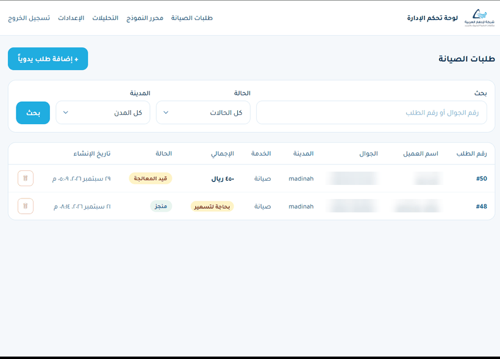

- **Requests inbox.** Search by phone or request number, filter by status and city, view price and date at a glance, add a request manually (for phone orders), and permanently delete with an explicit warning.
- **Request detail.** Full answers, uploaded files (served via short-lived signed URLs), pricing breakdown, status control and internal notes.
- **Technician PDF export.** A clean printable sheet rendered from real browser output (Puppeteer), so Arabic shaping is correct. It intentionally **shows no prices**, so the engineer sees what to do, not what was charged.
- **Instant email alerts.** Every new request, whether from a customer or entered by an admin, triggers a branded email with a deep link to the request.
- **Analytics.** KPI cards, revenue by service, requests over time (30 / 90 days), by status / city / service / AC type, a "needs attention" panel, plus **form UX insights**: completion rate, average completion time and the field where users abandon the form. These insights come from lightweight, non-personal events.
- **Form builder.** Add, edit, reorder, hide and delete sections and fields, manage dropdown options inline, set conditional visibility, and preview the live form, all without a deployment. Fields that already have answers are soft-deleted so historical data stays intact; the phone field is protected.
- **Pricing & coupon editors.** Edit every price and manage discount codes from the UI. Changes apply to the public form and to server-side calculation immediately.
- **Admins & permissions.** Create admins and grant per-page permissions (requests, form builder, settings, analytics). One super-admin always has full access.
- **Audit log.** Every sensitive action (status changes, deletions, permission changes, field edits, settings) is recorded with the actor, visible to the super-admin only and filterable by admin or action type.
- **White-label settings.** Site title, company name, logo and brand colours are editable and previewed live.

## Tech Stack

| Layer | Technology |
|-------|-----------|
| **Framework** | Next.js 16 (App Router, Server Actions, route handlers) |
| **UI** | React 19, TypeScript 5, Tailwind CSS 4, Tajawal Arabic font, RTL-first layout |
| **Database** | Supabase Postgres with Row-Level Security and `SECURITY DEFINER` RPCs |
| **Auth** | Supabase Auth (email + password) for the admin console |
| **File storage** | Supabase Storage with private buckets (receipts, photos, videos, invoices) and one public branding bucket |
| **SMS / OTP** | OurSMS provider behind a swappable interface; mock mode for local development |
| **Email** | Resend (new-request notifications, ops alerts) |
| **PDF** | Puppeteer (headless Chromium rendering) |
| **Hosting** | Railway: web service plus a separate cron service |
| **Scheduled jobs** | Railway cron (daily keep-alive, database backup, usage alerts, weekly summary) and `pg_cron` + an edge function (orphaned-upload cleanup) |

## System Architecture

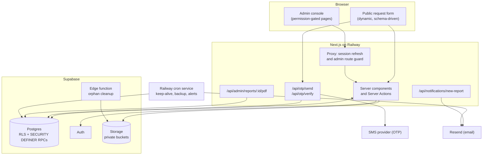

### Request lifecycle

The sequence below is the core of the design: the customer's browser is never trusted for price, identity or creation rights.

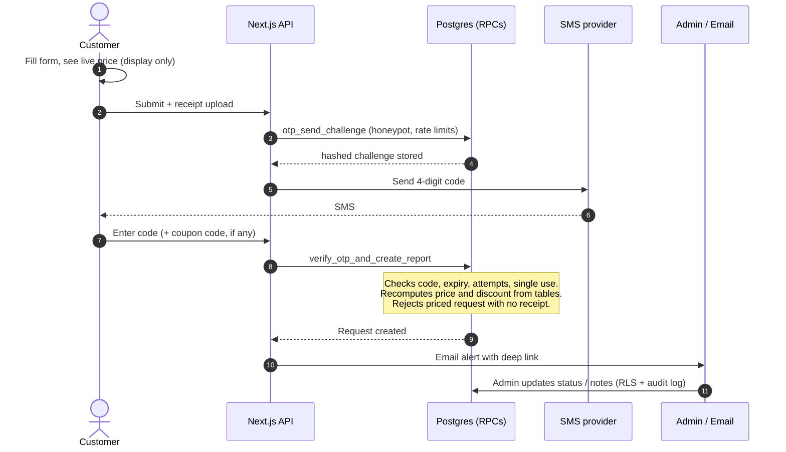

### Security model

- **No direct writes to requests.** `anon` and `authenticated` roles have no `INSERT` on the requests table. Creation is possible only through a `SECURITY DEFINER` function reachable via the server-side verify route.
- **Two-layer authorisation.** Admin permissions are enforced both in the app (page guards) and in Postgres (RLS via a permission helper function), so a bypassed UI still hits the database wall.
- **Private by default.** Receipts, photos and videos live in private buckets readable only by admins with the requests permission; the branding bucket is the only public one.
- **Sensitive analytics are gated.** Analytics run through permission-checked RPCs rather than raw table reads.
- **Hardening.** Security headers (HSTS, `X-Frame-Options: DENY`, `nosniff`, referrer policy), OTP test-code hard-disabled on any production runtime, secrets kept server-side only.

## Screenshots

### Customer (mobile)

  
  
  
  

### Admin dashboard

| | |
|---|---|
| 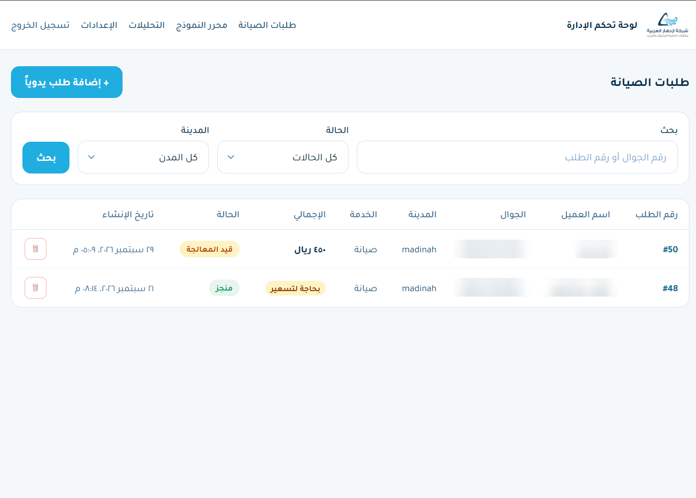 Requests inbox with search and filters | 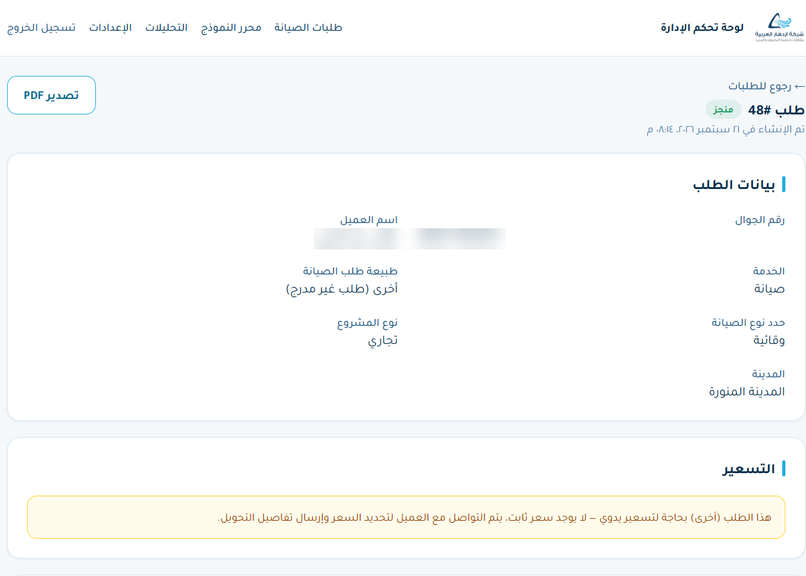 Request detail and PDF export |
|  Status workflow and internal notes | 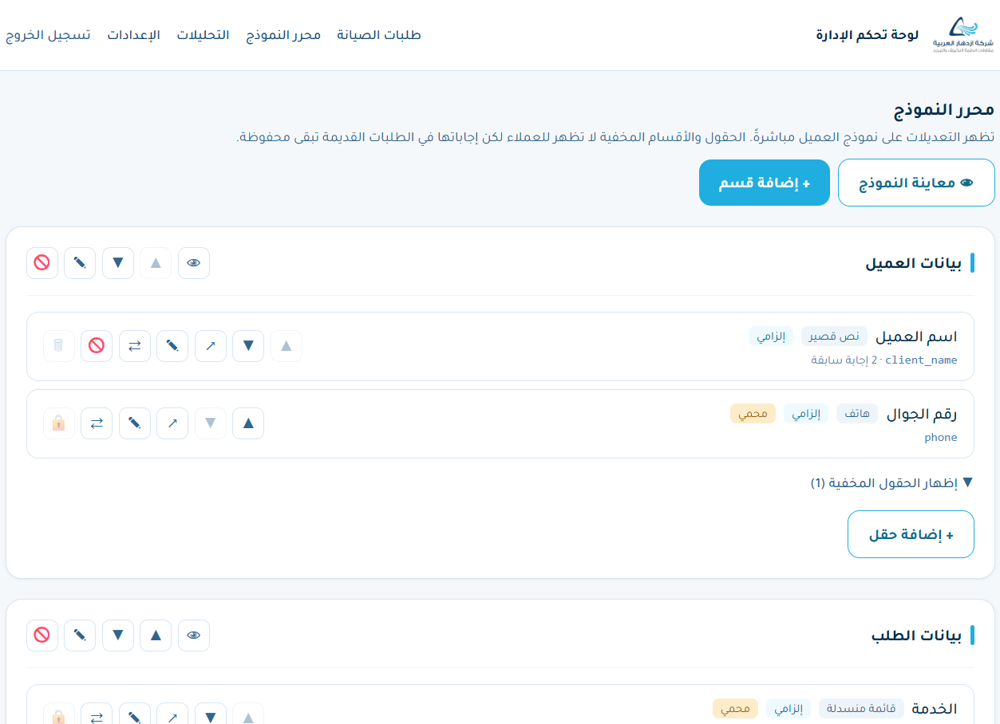 Form builder: sections, fields, conditions |
| 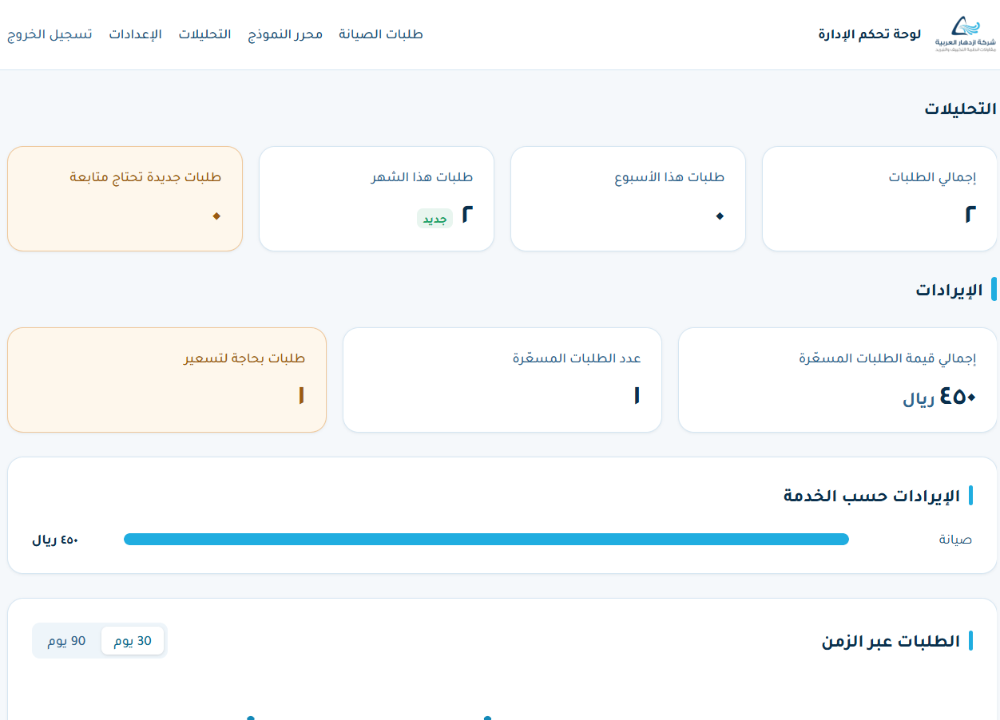 Analytics: KPIs and revenue | 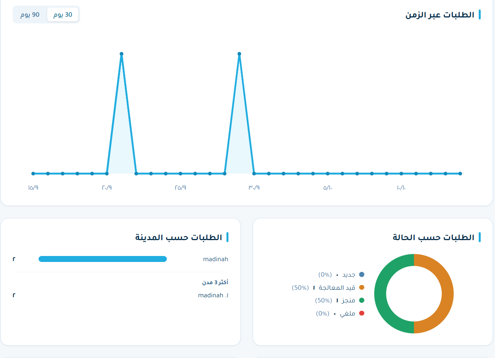 Requests over time, by status and by city |
| 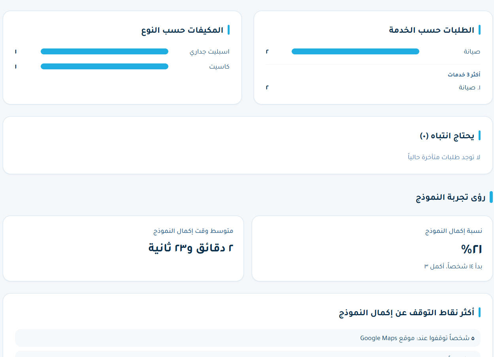 Form UX insights and needs-attention panel | 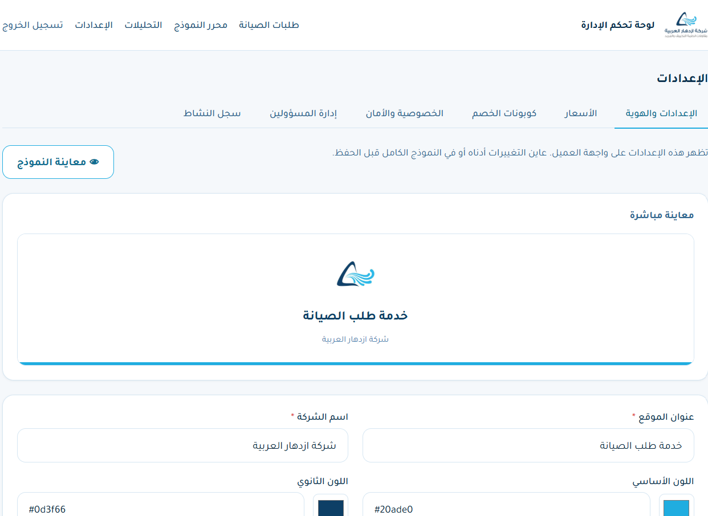 Branding and live preview |
| 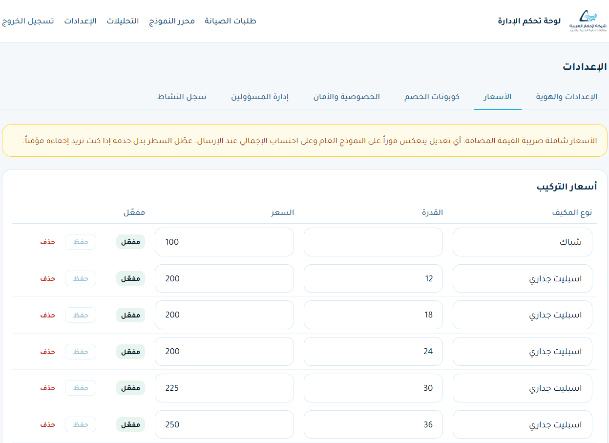 Price tables editor (VAT-inclusive) | 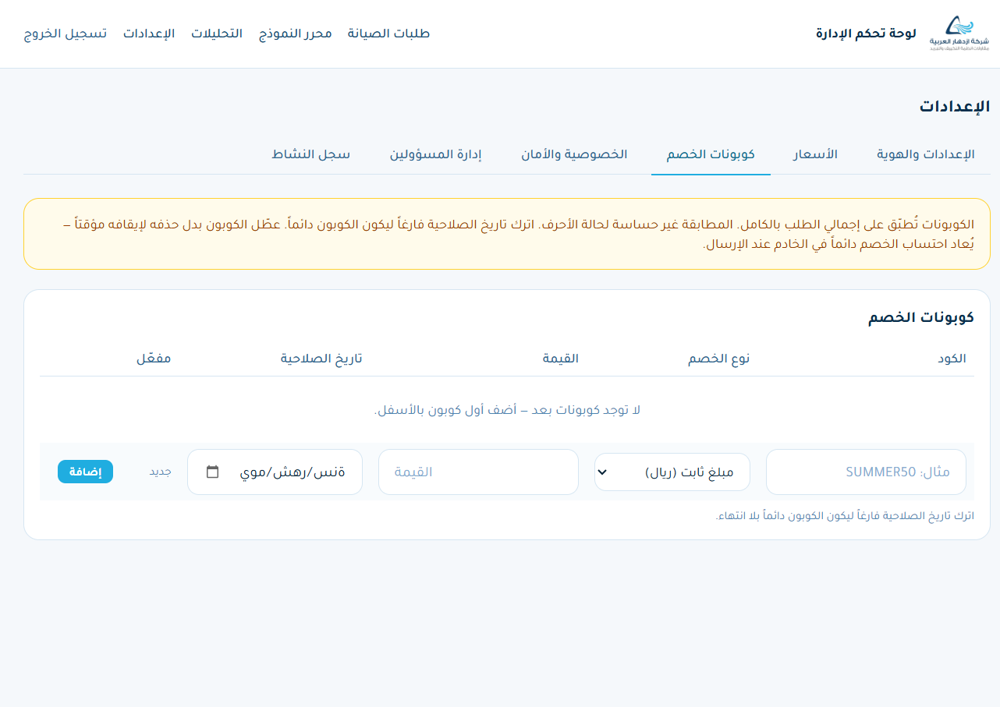 Discount coupons |
| 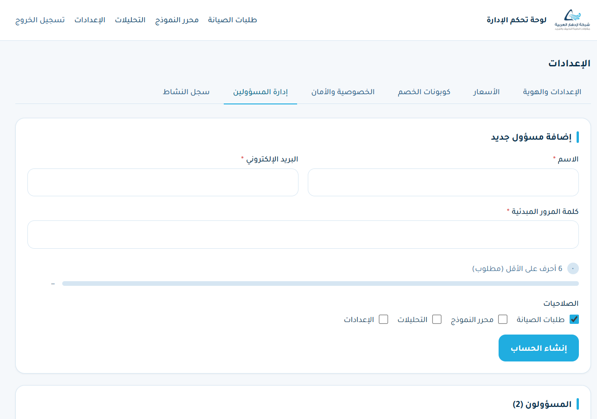 Admins and per-page permissions | 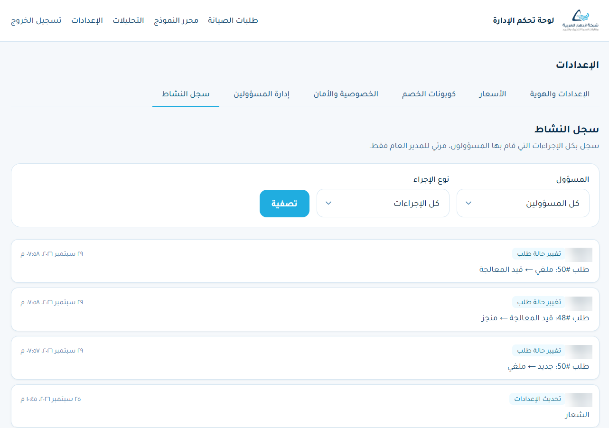 Audit log (super-admin only) |

> Personal data in the screenshots (customer names, phone numbers, bank details, staff names) has been blurred.

<!-- ## Live Demo
Add the public URL here if you want to link a live instance. -->

## My Role

I analysed the company's workflow and owned the product end to end:

- **Product & analysis:** mapped the four operational problems above and turned them into the request, payment and pricing flow.
- **UX:** designed the mobile-first Arabic (RTL) request form and the admin console.
- **Full-stack engineering:** Next.js and TypeScript front end and server logic; Postgres schema, Row-Level Security and RPC functions on Supabase.
- **Security:** server-side price authority, OTP verification, rate limiting, private storage, permission model and audit log.
- **Delivery & operations:** deployment on Railway, SMS and email integrations, scheduled backups, keep-alive and usage monitoring.

## Source Code Notice

This repository is a **showcase** of the project: analysis, architecture and interface screenshots. The source code is private because it is a live commercial system built for a client, and the screenshots have been blurred to remove personal and banking data.

## License

Documentation and images are shared for portfolio purposes. All rights reserved.
